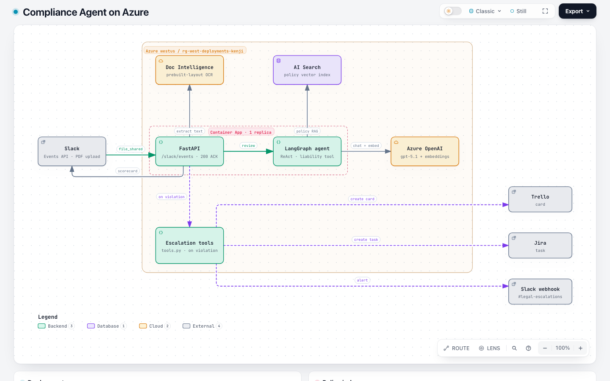

# Compliance Agent PoC

Slack-triggered vendor contract compliance agent. Uploading a PDF contract to Slack runs OCR, RAG policy checks, and liability math; violations escalate to Slack, Trello, and Jira.

## Architecture



Interactive version: [`architecture/azure-architecture.html`](architecture/azure-architecture.html) (open in a browser). Earlier diagrams are kept in `architecture/v1.png` (original target design) and `architecture/v2.png` (local PoC).

1. Slack posts a file event to FastAPI (`POST /slack/events`).
2. The API returns `200` immediately and processes in a background task.
3. Azure Document Intelligence (`prebuilt-layout`) extracts text from the PDF.
4. A LangGraph ReAct agent (Azure OpenAI) reviews the text against company policies retrieved from Azure AI Search and a liability calculator.
5. The scorecard is written back to the Slack thread. Violations also create Slack, Trello, and Jira tickets.

Policy documents in `data/` are indexed into Azure AI Search by `ingest_policies.py`; the app only queries the index at runtime, so it starts fast and needs no embedding calls at boot.

## Pipeline

```
Slack PDF upload
  → FastAPI webhook (idempotent, <3s ACK)
  → Background task: download PDF
  → Azure Document Intelligence (prebuilt-layout)
  → LangGraph agent (Azure OpenAI)
       ├─ company_policy_retriever (Azure AI Search)
       └─ calculate_liability_difference
  → Slack thread scorecard
  → On violation: Slack webhook + Trello card + Jira task
```

Escalation tools are invoked deterministically in Python when the scorecard contains `action required` or `🚨`, not by the LLM. The agent only uses the policy retriever and liability calculator.

## Project layout

| Path | Role |
|------|------|
| `main.py` | FastAPI app, Slack webhook, background processing, routing |
| `agent.py` | LangGraph ReAct agent + system prompt |
| `tools.py` | Liability calc, Slack/Trello/Jira escalation helpers |
| `ingestion.py` | Azure AI Search vector store + document loading/chunking helpers |
| `ingest_policies.py` | Loads `data/*.txt` into the Azure AI Search index (re-run when policies change) |
| `document_parser.py` | Azure Document Intelligence text extraction |
| `test_connection.py` | Azure OpenAI connectivity check |
| `Dockerfile`, `.dockerignore` | Container image for Azure Container Apps |
| `data/` | Company policy source files |
| `vendor_example/` | Sample MSA PDF for local parser tests |
| `architecture/` | Diagrams (generated with the Archify skill in `.claude/skills/archify`) |

## Prerequisites

- Python 3.11+
- Azure OpenAI (chat + embeddings deployments)
- Azure AI Document Intelligence
- Azure AI Search
- Docker and Azure CLI (for deployment)
- Slack app (bot token, Events API pointing at `/slack/events`, optional incoming webhook)
- Optional: Trello API credentials, Jira Cloud API token

## Setup

```bash
python -m venv .venv
source .venv/bin/activate  # Windows: .venv\Scripts\activate
pip install -r requirements.txt
```

Create a `.env` in the project root with the variables below.

### Environment variables

Create a `.env` in the project root (never commit secrets):

```bash
# Azure OpenAI
AZURE_OPENAI_API_KEY=
AZURE_OPENAI_ENDPOINT=
AZURE_OPENAI_DEPLOYMENT_NAME=
AZURE_OPENAI_EMBEDDING_DEPLOYMENT_NAME=
AZURE_OPENAI_API_VERSION=

# Azure Document Intelligence
DOC_INTEL_ENDPOINT=
DOC_INTEL_KEY=

# Azure AI Search
AZURE_SEARCH_ENDPOINT=      # https://<name>.search.windows.net
AZURE_SEARCH_KEY=
AZURE_SEARCH_INDEX_NAME=    # e.g. compliance-policies

# Slack
SLACK_BOT_TOKEN=
SLACK_SIGNING_SECRET=
SLACK_WEBHOOK_URL=          # #legal-escalations (or equivalent)

# Trello (optional escalations)
TRELLO_API_KEY=
TRELLO_TOKEN=
TRELLO_LIST_ID=

# Jira (optional escalations)
JIRA_DOMAIN=                # https://your-org.atlassian.net
JIRA_EMAIL=
JIRA_API_TOKEN=
JIRA_PROJECT_KEY=

# LangSmith (optional tracing)
LANGCHAIN_TRACING_V2=true
LANGCHAIN_API_KEY=
LANGCHAIN_PROJECT=
```

## Run

Populate the policy index once (and again whenever `data/` changes):

```bash
python ingest_policies.py
```

Then start the server:

```bash
uvicorn main:app --reload --host 0.0.0.0 --port 8000
```

Or with Docker:

```bash
docker build -t compliance-agent .
docker run --env-file .env -p 8000:8000 compliance-agent
```

Expose the service (ngrok, or the Container Apps URL below) and set the Slack Events Request URL to:

```
https://<host>/slack/events
```

Subscribe to `file_shared`, `message.channels` / `app_mention` as needed. Upload a vendor PDF in a channel the bot can access.

### Local smoke tests

```bash
python test_connection.py   # Azure OpenAI handshake
python ingestion.py         # Query the AI Search index with a sample policy question
python document_parser.py   # OCR sample PDF under vendor_example/
python tools.py             # Fire Slack/Trello test payloads
```

## Deploy to Azure Container Apps

The app runs as a single-replica Azure Container App in resource group `rg-west-deployments-kenji` (westus). The image lives in Azure Container Registry `myacrreg` and is pulled with a user-assigned managed identity that has `AcrPull`.

```bash
# Build the image in ACR
az acr build -r myacrreg -g rg-west-deployments-kenji -t compliance-agent:v2 .

# Roll out a new version
az containerapp update -g rg-west-deployments-kenji -n compliance-agent \
  --image myacrreg.azurecr.io/compliance-agent:v2
```

- API keys, tokens and webhook URLs are stored as Container Apps secrets and exposed to the app as env vars (`secretref:`); endpoints and deployment names are plain env vars.
- Keep `--max-replicas 1`: file-ID dedup is in-memory, so more replicas would process Slack retries twice.
- The container has no `.env` file; `load_dotenv()` only warns and configuration comes from the environment.
- The `gpt-4o-deploy` deployment name in Azure OpenAI currently points at a **gpt-5.1** model (gpt-4o had no quota); the name is kept so no app config changes.
- Document Intelligence is on the free F0 tier, which analyses only the first 2 pages of each PDF. Use S0 for full contracts.

## Agent behavior

- Temperature `0.0` for deterministic reviews.
- Retrieves top-3 policy chunks before deciding.
- Emits a fixed Slack markdown **Compliance Scorecard** (vendor name, overall status, financial review, security/data residency).
- Sample policy rules live in `data/security_policy.txt` (SOC 2 / GDPR, $5M liability floor, US-East-2 / US-West-2 hosting).

## Operational notes

- The `/slack/events` endpoint does not yet verify Slack request signatures (`SLACK_SIGNING_SECRET` is configured but unused); add this before relying on it publicly.
- Bot messages are ignored to avoid reply loops.
- File IDs are cached ~5 minutes to suppress Slack retry duplicates.
- Background failures update the Slack “thinking” message with an error string.
- LangSmith run metadata tags Slack channel / thread when tracing is enabled.
