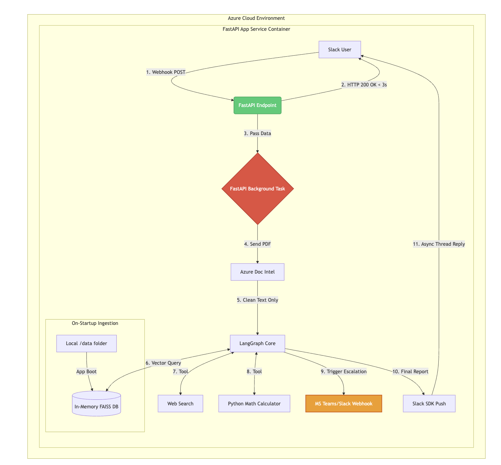
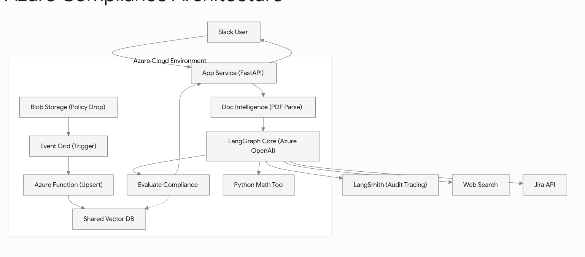

# Compliance Agent PoC

Slack-triggered vendor contract compliance agent. Uploading a PDF contract to Slack runs OCR, RAG policy checks, and liability math; violations escalate to Slack, Trello, and Jira.

## Architecture

### Current PoC (runtime)



1. Slack posts a file event to FastAPI (`POST /slack/events`).
2. The API returns `200` immediately and processes in a background task.
3. Azure Document Intelligence extracts plain text from the PDF.
4. A LangGraph ReAct agent reviews the text against company policies (FAISS RAG) and a liability calculator.
5. The scorecard is written back to the Slack thread. Violations also create Slack, Trello, and Jira tickets.

Policy documents in `data/` are embedded into an in-memory FAISS store on app boot.

### Target Azure layout



The longer-term design moves policy ingestion to Blob Storage → Event Grid → Azure Function → shared vector DB, with App Service hosting FastAPI and LangSmith for audit tracing.

## Pipeline

```
Slack PDF upload
  → FastAPI webhook (idempotent, <3s ACK)
  → Background task: download PDF
  → Azure Document Intelligence (prebuilt-read)
  → LangGraph agent (Azure OpenAI)
       ├─ company_policy_retriever (FAISS)
       └─ calculate_liability_difference
  → Slack thread scorecard
  → On violation: Slack webhook + Trello card + Jira task
```

Escalation tools are invoked deterministically in Python when the scorecard contains `action required` or `🚨`, not by the LLM. The agent only uses the policy retriever and liability calculator.

## Project layout

| Path | Role |
|------|------|
| `main.py` | FastAPI app, Slack webhook, background processing, routing |
| `agent.py` | LangGraph ReAct agent + system prompt |
| `tools.py` | Liability calc, Slack/Trello/Jira escalation helpers |
| `ingestion.py` | Load `data/*.txt` → chunk → FAISS embeddings |
| `document_parser.py` | Azure Document Intelligence text extraction |
| `test_connection.py` | Azure OpenAI connectivity check |
| `data/` | Company policy source files |
| `vendor_example/` | Sample MSA PDF for local parser tests |
| `architecture/` | Diagrams |

## Prerequisites

- Python 3.11+
- Azure OpenAI (chat + embeddings deployments)
- Azure AI Document Intelligence
- Slack app (bot token, Events API pointing at `/slack/events`, optional incoming webhook)
- Optional: Trello API credentials, Jira Cloud API token

## Setup

```bash
python -m venv .venv
source .venv/bin/activate  # Windows: .venv\Scripts\activate
pip install -r requirements.txt
```

Create a `.env` in the project root with the variables below.

### Environment variables

Create a `.env` in the project root (never commit secrets):

```bash
# Azure OpenAI
AZURE_OPENAI_API_KEY=
AZURE_OPENAI_ENDPOINT=
AZURE_OPENAI_DEPLOYMENT_NAME=
AZURE_OPENAI_EMBEDDING_DEPLOYMENT_NAME=
AZURE_OPENAI_API_VERSION=

# Azure Document Intelligence
DOC_INTEL_ENDPOINT=
DOC_INTEL_KEY=

# Slack
SLACK_BOT_TOKEN=
SLACK_WEBHOOK_URL=          # #legal-escalations (or equivalent)

# Trello (optional escalations)
TRELLO_API_KEY=
TRELLO_TOKEN=
TRELLO_LIST_ID=

# Jira (optional escalations)
JIRA_DOMAIN=                # https://your-org.atlassian.net
JIRA_EMAIL=
JIRA_API_TOKEN=
JIRA_PROJECT_KEY=

# LangSmith (optional tracing)
LANGCHAIN_TRACING_V2=true
LANGCHAIN_API_KEY=
LANGCHAIN_PROJECT=
```

## Run

```bash
uvicorn main:app --reload --host 0.0.0.0 --port 8000
```

Expose the service (ngrok, Azure App Service, etc.) and set the Slack Events Request URL to:

```
https://<host>/slack/events
```

Subscribe to `file_shared`, `message.channels` / `app_mention` as needed. Upload a vendor PDF in a channel the bot can access.

### Local smoke tests

```bash
python test_connection.py   # Azure OpenAI handshake
python ingestion.py         # Build FAISS + sample policy query
python document_parser.py   # OCR sample PDF under vendor_example/
python tools.py             # Fire Slack/Trello test payloads
```

## Agent behavior

- Temperature `0.0` for deterministic reviews.
- Retrieves top-3 policy chunks before deciding.
- Emits a fixed Slack markdown **Compliance Scorecard** (vendor name, overall status, financial review, security/data residency).
- Sample policy rules live in `data/security_policy.txt` (SOC 2 / GDPR, $5M liability floor, US-East-2 / US-West-2 hosting).

## Operational notes

- Bot messages are ignored to avoid reply loops.
- File IDs are cached ~5 minutes to suppress Slack retry duplicates.
- Background failures update the Slack “thinking” message with an error string.
- LangSmith run metadata tags Slack channel / thread when tracing is enabled.
